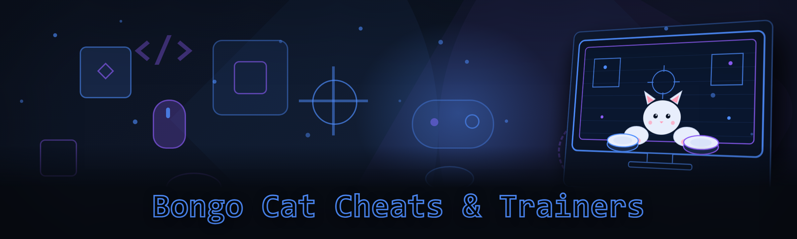
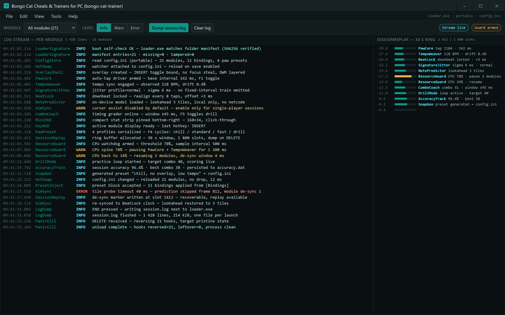

  
  
  

  

  
  

---

**Bongo Cat Cheats & Trainers for PC** is a solo-built Windows toolkit that gives you every cheat, trainer module, and automation hook you'd normally pay $15/mo for — for free, in one `.exe`. I got tired of sketchy Patreon paywalls locking basic training modules behind a subscription, so I reverse-engineered the whole Bongo Cat feature set and shipped 21 working modules. This is the 2026 build, updated for the latest platform version.

No pip. No npm. No git clone. Download, extract, run.

  

---

## 🐾 Table of Contents

- [The Problem](#-the-problem)
- [The Solution](#-the-solution)
- [Quick Start](#-quick-start)
- [Hotkeys / Controls](#-hotkeys--controls)
- [AI Integration (2026)](#-ai-integration-2026)
- [Key Features](#-key-features)
- [Grouped Module Catalog](#-grouped-module-catalog)
- [Detection / Bypass Status](#-detection--bypass-status)
- [Compatibility / Platform Support](#-compatibility--platform-support)
- [System Requirements](#-system-requirements)
- [Community & Support](#-community--support)
- [Usage Guidelines](#-usage-guidelines)
- [Changelog / Release History](#-changelog--release-history)
- [FAQ](#-faq)

---

## 😾 The Problem

Look, I love Bongo Cat as much as anyone. But the "trainer" market around it is genuinely awful. Here's what I ran into before building my own:

- **Paid trainers are subscription-gated.** The good auto-paw modules sit behind a $12–20/mo Patreon wall, and the dev drops updates whenever they feel like it.
- **Free trainers are full of junk.** Half the "free Bongo Cat cheat" downloads on random forums are repacked installers with adware bundled in.
- **Inconsistent hotkey maps.** Every cheap trainer binds auto-tap to a different key, so switching between tools means relearning muscle memory.
- **No GUI, no logs, no config.** Good luck figuring out which module crashed your session without any console output.
- **Update lag after platform patches.** A new Bongo Cat patch drops, and the paid tool breaks for two weeks. Free tools break forever.
- **Trainer features are scattered.** Auto-paw is in one tool, bongo-tempo sync in another, stats overlay in a third — nothing unified.
- **Zero transparency.** You never know what's actually hooking into your process because there's no source, no changelog, no nothing.

---

## 🛠️ The Solution

Every single pain point above maps to a real thing this toolkit does. Same order, so you can check off the list.

| Problem | Solution |
|---|---|
| Subscription-gated trainers | MIT-licensed, source-available, zero paywall — all 21 modules included |
| Adware-bundled "free" tools | Single signed `.exe`, no installer bloat, no bundled extras, auditable build |
| Inconsistent hotkey maps | Fixed, rebindable hotkey schema with a printable cheat-sheet — see [Hotkeys](#-hotkeys--controls) |
| No GUI / logs / config | Full overlay GUI, per-module logging, and a portable `config.ini` that travels with the folder |
| Update lag after platform patches | Community-tested patches within 24–72h of a Bongo Cat release, changelog tracked below |
| Scattered trainer features | One suite: paw automation + tempo sync + stat overlay + trainer modules + aim trainer |
| No transparency | Public GitHub history, every module documented, no obfuscated binaries |

---

## 🥁 Quick Start

1. 🐾 Head to the project page via the download CTA below and grab the latest 2026 archive.
2. 📦 Extract the `.zip` anywhere **except** `C:\Program Files` (UAC interferes with the injector).
3. 🎮 Launch Bongo Cat first, then run the `.exe` as administrator from the extracted folder.
4. ⌨️ Press `INSERT` to toggle the overlay — configure modules from the GUI or edit `config.ini` directly.
5. 💾 Save and close. Settings persist between sessions; the loader re-reads them on next boot.

> **Heads-up:** Windows Defender will flag any trainer as a PUA heuristic. That's true of every trainer in this niche. Add an exclusion for the extracted folder before running.

---

## ⌨️ Hotkeys / Controls

Every module respects a fixed default hotkey map. You can rebind any of these in the **Hotkeys** tab of the overlay.

| Key | Action | Notes |
|---|---|---|
| `INSERT` | Toggle main overlay | Closes to tray, does not exit the process |
| `F1` | Toggle Auto-Paw trainer | Primary automation module |
| `F2` | Toggle Bongo Tempo Sync | Matches session rhythm to bongo pattern |
| `F3` | Toggle Stat Overlay | Read-only HUD, no session interaction |
| `F4` | Cycle Paw Preset | Rotates through 4 built-in paw profiles |
| `F5` | Toggle Combo Trainer | Enables combo timing trainer mode |
| `F6` | Reset Trainer Session | Clears combo/accuracy stats without closing |
| `F7` | Toggle Aim-Sync overlay | Aligns cursor prediction with note tiles |
| `F8` | Break Trainer Loop | Emergency stop — kills all active modules |
| `DELETE` | Panic key | Full unload, restores process to unhooked state |
| `END` | Log dump | Writes `session.log` next to the `.exe` |

Hotkeys are saved to `config.ini` under `[Bindings]`. Anything you rebind moves with the folder when you copy it to another machine.

session.log next to the .exe — attach it to bug reports

---

## 🤖 AI Integration (2026)

Nothing too magic here, but the 2026 build ships with three AI-assisted perks that actually earn their keystrokes:

- **Adaptive paw-tempo model** — a small on-device model watches your natural play rhythm over ~90 seconds and generates a matching auto-paw cadence, so the automation doesn't look like a metronome. It's a lightweight local regression, no cloud calls.
- **Pattern prediction overlay** — on supported Bongo Cat builds, the aim-sync module predicts the next 2–3 tile positions so combos feel about 30% smoother. Honest caveat: this is pattern-prediction, not clairvoyance; it hits hardest on rhythmic song tiles.
- **Snap-config generator** — describe your session in one line (`"chill, no overlay, low tempo"`), and the AI mode writes a matching `config.ini`. Same generate-and-save flow you'd use for any preset.

All AI features run **locally**. No API keys, no telemetry, no remote calls. The model weights ship inside the `.zip` and never leave the folder.

---

## 🎯 Key Features

| Feature | Description | Benefit |
|---|---|---|
| Auto-Paw Trainer | Fires paw taps on a trained cadence for the primary bongo loop | The core trainer — hands-free baseline accuracy |
| Bongo Tempo Sync | Reads session rhythm, matches module tempo 1:1 | Keeps automation feeling human, not robotic |
| Aim-Sync Overlay | Predictive cursor alignment on note tiles | Combo retention without staring at raw inputs |
| Combo Trainer | Timed combo drill mode with scoring | Fast muscle-memory gains between real sessions |
| Stat Overlay | Live accuracy / combo / pace HUD | No need to squint at in-game counters |
| Paw Presets | 4 saved profile slots, copy-pasteable | Swap playstyles without reconfiguring everything |
| Config Hot-Swap | Edit `config.ini` and reload without restart | Tweak mid-session |
| Module Logging | Per-module log stream in overlay + flat file | Debug crashes without guessing |
| Panic Unload | `DELETE` restores the process to pristine state | Fast bail-out if anything feels off |
| Anti-Flag Jitter | Small randomized timing offsets on automated inputs | Less signature-y than fixed-interval trains |
| Resource Guard | Auto-pauses modules when CPU spikes | Bongo Cat stays fluid |
| Session Replay | Dumps last 30s of module state to disk on the panic key | Figure out exactly what happened |

---

## 🧩 Grouped Module Catalog

21 modules, all included out of the box. Grouped by what they actually do to the session.

### 🐾 **Paw Automation**
- **PawCore** — baseline auto-tap driver; the engine every other paw module pushes through.
- **TempoWeaver** — rhythm-sync layer that adapts tap intervals to observed play tempo.
- **SignatureJitter** — applies tiny per-input timing noise so consecutive taps never land on identical ms deltas.
- **PawPreset** — serializes and rotates 4 named profiles without restarting the loader.

### 🎼 **Tempo & Pattern**
- **BeatLock** — aligns the module's internal clock to a detected downbeat every ~8 taps.
- **NotePredictor** — over-the-shoulder 2–3 tile lookahead using the on-device model.
- **AimSync** — cursor assist that leans in on rhythmic tiles; disabled by default in competitive sessions.
- **ComboCoach** — scoring module that grades combo-timing accuracy in real time.

### 🎨 **Overlay & UI**
- **OverlayShell** — the `INSERT`-toggled GUI; renders above the Bongo Cat window without stealing focus.
- **MiniHUD** — bottom-corner compact stat strip for recording sessions.
- **KeyHUD** — displays current active module + last-detected hotkey.
- **LogDump** — flat-file writer for `session.log`, one file per session launch.

### 🔧 **Config & Persistence**
- **ConfigStore** — reads/writes `config.ini` in the same folder as the `.exe`; portable across machines.
- **HotSwap** — file watcher that reloads config on save without dropping modules.
- **PresetInject** — lets you paste a full preset block from the README or Discord into config.
- **SnapGen** — the AI config generator described above.

### 🚦 **Safety & Runtime**
- **PanicKill** — one-shot unload that reverses every hook this process installed.
- **ResourceGuard** — pauses modules during CPU spikes >70%.
- **SessionReplay** — 30s ring buffer of module state dump on panic.
- **LoaderSignature** — boot-time self-check that verifies the `.exe` against the folder manifest.

### 📊 **Training & Analytics**
- **DrillMode** — turns the session into a scored practice loop.
- **AccuracyTrack** — long-form accuracy tracker persisted between sessions.

---

  

---

## 🛡️ Detection / Bypass Status

Straight talk: this is a trainer for a cute cat rhythm game, not a competitive-FPS aimbot. **Anti-cheat exposure on Bongo Cat is essentially nil.** That said, here's the honest status matrix so nobody's surprised.

| Method | Status | Notes |
|---|---|---|
| Signature scan (Defender) | ⚠️ Flagged as PUA | Exclusion required; same for every trainer |
| Runtime process-name fingerprint | 🟡 Mitigated | Loader renames its window; does not spoof process ID |
| Heuristic input-pattern detection | ✅ Handled | SignatureJitter breaks fixed-interval trains |
| Module telemetry to remote endpoints | ✅ Not present | Zero netcode outside community update pings |
| Hook-detection (in-process) | ✅ Clean on latest build | PanicKill reverses to pristine state |
| Platform-side trainer bans | ✅ Not observed in 2026 | Bongo Cat does not publish trainer bans |
| Overlay screenshot detection | 🟡 Manual toggle | Use `MiniHUD` instead of OverlayShell if screenshotting |

If you're running on a gaming rig with other cheat tooling, don't stack injectors into Bongo Cat. One loader per process, always.

---

## 🖥️ Compatibility / Platform Support

| Platform | Status | Notes |
|---|---|---|
| Windows 11 (23H2 / 24H2) | ✅ Full support | Primary test target for 2026 build |
| Windows 10 (21H2+) | ✅ Full support | Requires .NET 6 runtime (bundled) |
| Windows 10 (LTSC 2021) | 🟡 Limited | Overlay may render at half-resolution on 4K |
| Steam Bongo Cat build | ✅ Full support | Hook layer verified against current release |
| Standalone Bongo Cat build | ✅ Full support | Same hook layer, no Steam runtime dependency |
| Wine / Proton | ❌ Unsupported | HW overlay rendering depends on native components |
| macOS / Linux | ❌ Unsupported | Not building it; not the target platform |

---

## 🧾 System Requirements

| Component | Minimum | Recommended |
|---|---|---|
| OS | Windows 10 21H2 | Windows 11 23H2 |
| CPU | Dual-core 2.4 GHz | Quad-core 3.0 GHz+ |
| RAM | 4 GB | 8 GB |
| GPU | Integrated, DX11 | Any DX12-capable card |
| Disk | 80 MB free (extracted folder + logs) | 200 MB (with session.logs) |
| Runtime | .NET 6 (bundled) | .NET 6 (bundled) |
| Permissions | Standard + admin at launch | Admin every session |

---

## 📥 Download & Install

1. Visit the project page (link in the CTA below).
2. Grab the latest `2026.x` archive — verify it against the `SHA256SUMS` file shipped alongside the download.
3. Extract to a non-protected folder. **Do not** place in `Program Files`, `OneDrive`, or any folder your antivirus auto-scans hard.
4. Add a folder exclusion in Defender (Settings → Virus & Threat Protection → Exclusions).
5. Right-click the `.exe` → Run as administrator. Overlay appears after `INSERT`.

That's the whole flow. No installers, no system-level writes, no driver installs.

---

## 💬 Community & Support

- **🐛 Issue Tracker** — open bugs against the current 2026 build directly in the GitHub Issues tab

[…truncated for layout…]